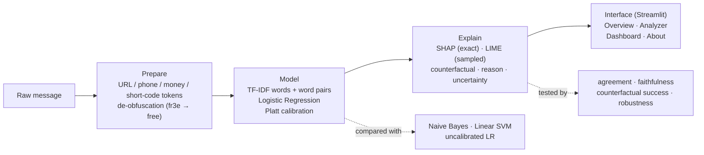

# MATRIX: Every Threat Leaves a Trace

**Explainable suspicious-message detection for everyday users and security analysts**

| | |
|---|---|
| **Team** | CharmedAI |
| **Team members** | ⚠️ _TO ADD: Name 1 (Team Leader) · Name 2 · Name 3 · Name 4_ |
| **Hackathon** | AI Innovation Hackathon 2026, Women in AI, Research, Innovation & Entrepreneurship Club |
| **Track** | Explainable AI (XAI) |
| **Problem statement** | Challenge 05: *Explain Why a Message Looks Suspicious* |
| **Live demo** | ⚠️ _TO ADD: Streamlit Community Cloud link_ |
| **Demo video** | ⚠️ _TO ADD: video link_ |

---

## Problem

Spam and suspicious-message filters give a verdict, never a reason.

- **Real messages get blocked**, and users never learn why.
- **Harmful messages slip through**, and without reasons nobody can see what the model missed.
- **Analysts cannot debug a bare label**, so false positives are impossible to trace.

## Proposed solution

MATRIX takes any SMS or e-mail text and returns:

1. **A verdict with a calibrated probability**: "90%" means roughly 9 in 10 such messages really are spam.
2. **An uncertainty level** with plain reasons: borderline score, unfamiliar words, very short message, or explanation methods that disagree.
3. **The words that drove the decision, highlighted where they were typed**, using SHAP (exact) or LIME (sampled).
4. **A plain-language reason**, e.g. *"Flagged mainly for a request to call, text or click (a phone number, “call”), backed up by a prize or reward offer (“claim”, “WON”)."*
5. **A counterfactual**: the words whose removal flips the decision, with the model's real score after every step.

For analysts, a dashboard adds the evaluation results, a confusion matrix, an explorer for wrongly
flagged and missed messages, the strongest spam and legitimate signals, and **tests of the
explanations themselves**: LIME–SHAP agreement, faithfulness, counterfactual success and robustness.

## Key features

| Feature | What it does |
|---|---|
| Calibrated verdict | Platt scaling fitted on out-of-fold training scores; shown with honest rounding (never a flat 0% or 100%) |
| Uncertainty notes | Flags borderline scores (20–80%), messages whose words the model never saw, very short messages, and low LIME–SHAP agreement |
| Word highlighting | SHAP attributions mapped back to the exact characters typed (strong / weak spam signals, signs of a normal message) |
| Plain-language reason | Signal words grouped into families: prize offer, urgency, call-to-action, premium pricing, marketing |
| Counterfactual | Greedy removal, every candidate re-scored by the model, then pruning of unneeded removals; a step table shows the real score after each edit |
| SHAP vs LIME | Side-by-side chart in each method's own units, with overlap, rank correlation, direction agreement and LIME's fit (R²) |
| Score breakdown | Waterfall chart: average message + each word + words not in the message = this message's score |
| De-obfuscation | Undoes `fr3e`, `c@sh`, `f r e e`, `freeeee` and invisible zero-width characters before the model sees the text |
| Robustness | 9 edits (leetspeak, spacing, stretching, typos, synonyms, capitals, changed link, defanged link, added greeting) on spam **and** normal messages, with and without de-obfuscation; also run live on any single message |
| Error explorer | Analysts browse wrongly flagged and missed messages, each with the full explanation |
| Trust Lab | Edit a message (or apply a typo, leetspeak, spacing, capitals, synonym or greeting change), then compare original vs edited: real probabilities, highlighted words, SHAP–LIME agreement and which top words changed |
| Prediction instability warning | Documented rule: an edit of at most 4 words (or 30% of words, ignoring case) that flips the verdict or moves the probability by 20+ points is flagged; shown in the Analyzer and Trust Lab |
| Phishing patterns (rule-based) | Separate, clearly labelled check for links, urgency, requests to confirm details, personal/payment details, delivery or prize lures and account threats. It never changes the ML probability; it adds a caution when an unflagged message shows several patterns |

## Technology stack

| Layer | Tools |
|---|---|
| Language | Python 3.13 |
| Machine learning | scikit-learn 1.9.1 (TF-IDF, Logistic Regression, Platt calibration, Naive Bayes, Linear SVM), NumPy, SciPy, pandas, joblib |
| Explainability | SHAP and LIME implemented in `src/explain.py` (cross-checked by `notebooks/verify_xai.py` against the official `shap` / `lime` packages) |
| Interface | Streamlit 1.66 (five pages), Plotly 7 charts, custom "Soft Plum & Ivory" CSS |
| Testing | pytest (61 automated tests) |
| Deployment | Streamlit Community Cloud (main file `app.py`) |

## Architecture / workflow



```
.
├── app.py                  Streamlit entry point: loads the model, header + navigation, routes pages
├── src/                    machine learning (no interface code)
│   ├── data.py             loads the UCI SMS Spam Collection, removes duplicates
│   ├── preprocess.py       tokenizer that keeps character spans, placeholders, de-obfuscation
│   ├── model.py            TF-IDF + Logistic Regression + Platt calibration
│   ├── explain.py          SHAP, LIME, counterfactuals, reasons, agreement, uncertainty
│   ├── robustness.py       edits/attacks and stability metrics, single-message probe
│   ├── indicators.py       rule-based phishing patterns (separate from the ML model)
│   ├── trust_lab.py        Trust Lab page: edit, compare, instability warning
│   └── train.py            training + full evaluation, writes everything in models/
├── ui/                     interface ("Blush Rose & Cocoa" design system)
│   ├── theme.py            colours, CSS, icons, chart style, safe escaping of user text
│   ├── components.py       verdict card, highlighting, counterfactual table, charts
│   ├── analysis.py         runs the model + explanations once and returns plain data
│   └── pages.py            Overview, Message Analyzer, Analyst Dashboard, About & Methodology
├── tests/                  61 automated tests (pytest)
├── models/                 trained model and evaluation outputs (generated by src/train.py)
├── data/                   dataset (see data/README.md)
├── notebooks/verify_xai.py optional cross-check against the official shap / lime packages
├── documentation/          demo script and submission checklist
├── demo/                   screenshots and demo video
├── .streamlit/config.toml  theme and app settings
├── requirements.txt        pinned runtime dependencies
└── requirements-dev.txt    tests + optional shap / lime
```

## Methodology

| Component | Choice | Why |
|---|---|---|
| Features | TF-IDF on words and word pairs (min_df 2, sublinear tf), with placeholder tokens | The model learns "contains a premium phone number", not one specific number |
| Model | Logistic Regression (C = 10, liblinear) | Linear, so every prediction splits **exactly** into one contribution per feature |
| Calibration | Platt (sigmoid) scaling on 5-fold out-of-fold scores; the vectoriser is refit inside each fold | Probabilities that mean what they say, with no leakage between calibration folds. Monotonic, so it never changes which words matter |
| Comparisons | Uncalibrated LR, Multinomial Naive Bayes (α = 0.1), Linear SVM (C = 1, Platt) | Same text preparation, same features, same folds: checks we are not trading accuracy for explainability |
| SHAP | φⱼ = wⱼ(xⱼ − μⱼ), μ = average training document (Lundberg & Lee, 2017) | The exact interventional SHAP value for a linear model, as `shap.LinearExplainer` computes it. It explains the **raw score (log-odds) before calibration** |
| LIME | Random word removal, cosine kernel (width 25), weighted ridge surrogate on the calibrated probability (Ribeiro et al., 2016) | An independent, model-agnostic check; its fit (R²) is reported |
| Counterfactuals | Greedy removal tested on the model at every step (ranked by raw score), then pruning; max 10 words; filler words never suggested | A small edit that flips the label. Not guaranteed to be the smallest possible |
| Validation | Duplicates removed **before** a stratified 80/20 split (seed 42); 5-fold CV on the training part only | The test set is never used to train, tune or calibrate |
| Explanation tests | Top-5 overlap, Spearman correlation, direction agreement, LIME repeatability, deletion (faithfulness) test, counterfactual success, robustness | We test the explanations, not only the classifier |

Two choices sit on top of SHAP and are stated as such: a word pair's value is shared equally
between its two words (so each word gets one number to highlight), and features *absent* from a
message (words it does not contain) are reported as one extra "words not in message" term
instead of being hidden. A unit test checks the SHAP formula against brute-force Shapley values
computed over every coalition of a message's features.

## Installation

Requires Python 3.13 (tested on Windows 11). No GPU needed. The pinned packages in `requirements.txt` need Python 3.13, and the saved model must be loaded with scikit-learn 1.9.1.

**Windows (PowerShell)**

```powershell
git clone <this repo>
cd <repo>
python -m venv .venv
.venv\Scripts\Activate.ps1
pip install -r requirements.txt
```

**macOS / Linux**

```bash
python3 -m venv .venv && source .venv/bin/activate
pip install -r requirements.txt
```

Then put the dataset in `data/` (see [Dataset](#dataset)).

## Usage

```bash
python -m src.train          # trains and evaluates; writes the model and all results to models/ (~3 min)
streamlit run app.py         # opens the app at http://localhost:8501
```

`python -m src.train --fast` trains the model and the test metrics only (seconds); the dashboard
then shows what is available and says which parts need the full run. The app never trains on its
own: if the model is missing, or was saved with another scikit-learn version, it says so and shows
the command to run.

Tests:

```bash
pip install -r requirements-dev.txt
pytest
```

The tests cover the tokenizer, SHAP (against brute-force Shapley values), LIME reproducibility,
counterfactual correctness, uncertainty notes, robustness edits, safe display of user text, all
four app pages, and, when the dataset and model are present, no train/test overlap, metrics that
recompute from the saved predictions, and exact reproducibility of the saved model from the seed.

## Deployment (Streamlit Community Cloud)

1. Push this folder to GitHub, including `models/` (trained model + evaluation results) and
   `data/SMSSpamCollection` (CC BY 4.0, redistributable with the attribution below).
2. On share.streamlit.io choose the repository, main file `app.py`, and **Python 3.13** under
   Advanced settings.
3. No secrets are needed. The app never trains on startup; it loads `models/matrix.joblib`.

## Dataset

**UCI SMS Spam Collection** (Almeida & Hidalgo, 2011): 5,574 English SMS messages labelled
ham / spam (747 spam). After removing exact duplicates, **5,171 unique messages** remain
(12.6% spam). License: CC BY 4.0.
Download <https://archive.ics.uci.edu/dataset/228/sms+spam+collection> and place the file
`SMSSpamCollection` in `data/` (the Kaggle copy `spam.csv` also works).

Duplicates (403) are removed **before** splitting so that the same message never appears in both
training and test data.

## Models used

- **MATRIX model:** TF-IDF (1–2 grams, min_df = 2, sublinear tf) → Logistic Regression (C = 10) → Platt calibration. Decision threshold 0.5.
- **Comparison models:** uncalibrated Logistic Regression, Multinomial Naive Bayes (α = 0.1), Linear SVM (C = 1, Platt-calibrated).
- No pre-trained models are used. Trains in about 3 minutes on a laptop CPU.

## Results

<!-- RESULTS -->
All numbers come from `python -m src.train` (seed 42) and are saved in `models/report.json`.
The test set is 1,035 held-out messages (131 spam, 904 normal) never used for training,
tuning or calibration.

**MATRIX on the held-out test set**

| Precision | Recall | F1 | False-positive rate | ROC-AUC |
|---|---|---|---|---|
| 0.992 | 0.931 | 0.961 | 0.11% (1 of 904) | 0.998 |

Confusion matrix: 122 spam caught, 9 missed, 903 normal messages passed, 1 wrongly flagged.
5-fold cross-validation on the training data: F1 0.961 ± 0.016, precision 0.980, recall 0.943.

**Model comparison** (same features and folds)

| Model | CV F1 (± std) | Test F1 | Test FPR | Wrongly flagged | Missed spam |
|---|---|---|---|---|---|
| **MATRIX** (LR + Platt) | 0.961 ± 0.016 | 0.961 | 0.11% | 1 | 9 |
| Logistic Regression, uncalibrated | 0.942 ± 0.030 | 0.952 | 0.11% | 1 | 11 |
| Multinomial Naive Bayes | 0.959 ± 0.019 | 0.953 | 0.22% | 2 | 10 |
| Linear SVM (Platt) | 0.957 ± 0.020 | 0.961 | 0.11% | 1 | 9 |

MATRIX ties the Linear SVM on the test set and has the best cross-validated F1; the differences
between models are within one standard deviation. We keep Logistic Regression because its word
explanations are exact.

**Calibration:** expected calibration error falls from 0.0167 (raw) to 0.0039 (calibrated);
Brier score from 0.0095 to 0.0081.

**Explanation quality** (test messages)

| Test | Result |
|---|---|
| LIME–SHAP top-5 word overlap | 84% (298 messages); 1% fall below 60% and get a warning |
| Rank correlation (Spearman) | 0.90 |
| Same direction on shared top words | 98% |
| LIME repeatability (top-5 overlap across 3 seeds) | 89% |
| LIME local fit (mean R²) | 0.41: low when scores sit near 0% or 100% |
| Faithfulness: score drop after removing the top 3 words | SHAP 1.49, LIME 1.51, random words 0.16 (log-odds, 262 messages) |
| Counterfactual found for flagged messages | 96% of 123; median 5 words removed; 10% flip with one word |

**Robustness** (the 2 words driving each verdict are disguised, or the whole message is edited;
share of correctly classified messages whose verdict is unchanged)

| Edit | Spam still caught: MATRIX | without de-obfuscation | Top-3 explanation words kept: MATRIX | without |
|---|---|---|---|---|
| Leetspeak (`fr3e`) | 100% | 97.5% | 100% | 77% |
| Spaced letters (`f r e e`) | 99.2% | 91.7% | 97.5% | 73% |
| Stretched letters (`freeee`) | 100% | 97.5% | 100% | 74% |
| Typo (swapped letters) | 98.3% | 98.3% | 79% | 79% |
| Synonym | 99.1% | 99.1% | 75% | 75% |
| Capital letters | 100% | 100% | 100% | 100% |
| Different link (16 messages with a link) | 100% | 100% | 100% | 100% |
| Defanged link `www[.]x[.]com` (16) | 93.8% | 93.8% | 67% | 67% |
| Added greeting | 96.7% | 96.7% | 99.7% | 99.5% |

Normal messages keep their verdict after every edit (≥ 99.3%), so the edits do not create
false positives. De-obfuscation matters most for the explanation: without it, a disguised word
drops out of the top explanation words.
<!-- /RESULTS -->

## Screenshots / demo

⚠️ _TO ADD: screenshots in `demo/` and the demo video link._ See
[`documentation/demo_script.md`](documentation/demo_script.md) for a tested demo walkthrough.

## Limitations

- **Old, British, SMS-only training data.** The data is English SMS from the UK, mostly from the
  2000s. Modern scams are less reliable: a parcel-redelivery message with a link scores about
  45% (borderline, not flagged). MATRIX marks such results as uncertain rather than hiding it.
- **Money amounts weigh heavily.** "I owe you $5 and $10 tomorrow" scores well above 50% on its
  own, because amounts were common in the training spam.
- **Bag of words.** The model sees words, not meaning: an unseen synonym ("complimentary" for
  "free") can weaken detection, and very short messages give too little evidence (MATRIX flags
  one- and two-word messages as high uncertainty).
- **Defanged links** such as `www[.]site[.]com` are not recognised as links.
- **Dataset artefacts:** some messages in the UCI file contain HTML codes such as `&lt;#&gt;`,
  shown as they are.
- **LIME is random**, so its ranking can vary slightly between runs; the SHAP view is exact.
- **The counterfactual is greedy:** it finds a small edit, not always the smallest possible one.
- "Suspicious" is a statistical signal with a confidence score, never proof. MATRIX is a decision
  aid; people decide.

## Future scope

- DistilBERT comparison, with explanations from the same SHAP / LIME tests.
- UCI Spambase (e-mail, 57 numeric features) to test explanations on feature-level data.
- Recognise defanged links; multilingual and modern e-mail datasets; URL reputation features.
- Analyst feedback loop: mark false positives in the explorer and retrain.
- Browser / mail-client plug-in that shows the highlighted reason next to the message.

## Responsible AI

- Public data only. No private messages or credentials are used or stored.
- Messages pasted into the app are kept only in that browser session's memory: not written to
  disk, logged, cached across users, or sent anywhere. (The interface font is loaded from Google
  Fonts; nothing else leaves the machine.)
- Confidence is calibrated and shown with honest rounding (never a flat 0% or 100%), together
  with an uncertainty level and its reasons.
- Explanations come with reliability checks (LIME–SHAP agreement, faithfulness) and their
  limits are stated in the app.
- User text is always escaped before display, so pasted HTML or Markdown is shown, never run.

## External resources and attributions

- Dataset: Almeida, T. A. & Hidalgo, J. M. G. (2011). *SMS Spam Collection*. UCI Machine Learning Repository. https://doi.org/10.24432/C5CC84 (CC BY 4.0)
- Lundberg, S. & Lee, S.-I. (2017). *A Unified Approach to Interpreting Model Predictions* (SHAP). NeurIPS.
- Ribeiro, M. T., Singh, S. & Guestrin, C. (2016). *"Why Should I Trust You?" Explaining the Predictions of Any Classifier* (LIME). KDD.
- Platt, J. (1999). *Probabilistic Outputs for Support Vector Machines and Comparisons to Regularized Likelihood Methods*.
- Libraries: scikit-learn, NumPy, pandas, SciPy, joblib, Streamlit, Plotly (tests: pytest; optional checks: shap, lime).
- Font: DM Sans (SIL Open Font License), via Google Fonts. Icons: line icons drawn for MATRIX in the Lucide style.

### Use of AI tools

In line with Section 9 of the hackathon rules, we disclose that we used Claude (Anthropic) as
an AI coding assistant for code generation, debugging, testing and documentation drafting during
the hackathon. The team designed the solution (see our Stage 1 proposal), reviewed and tested
the code, and can explain every component.

## License

MIT, see [LICENSE](LICENSE).
